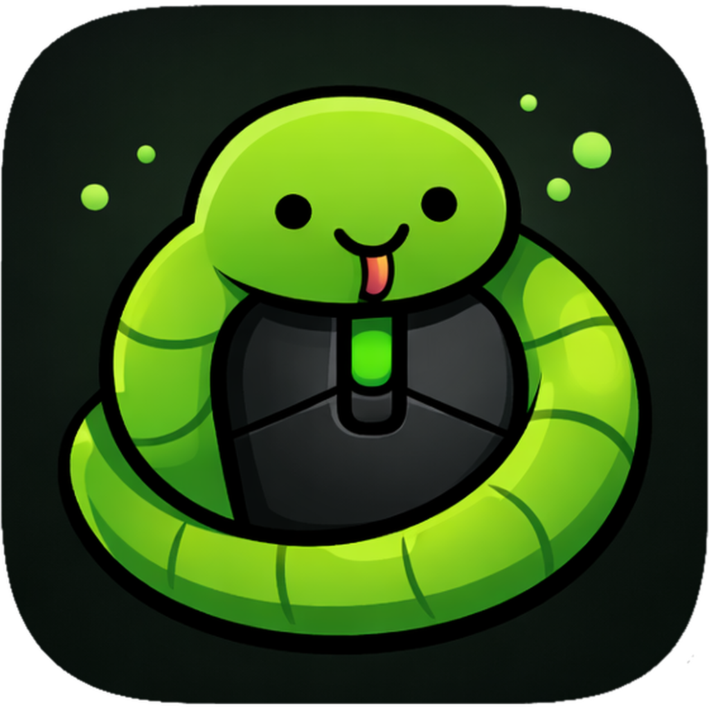
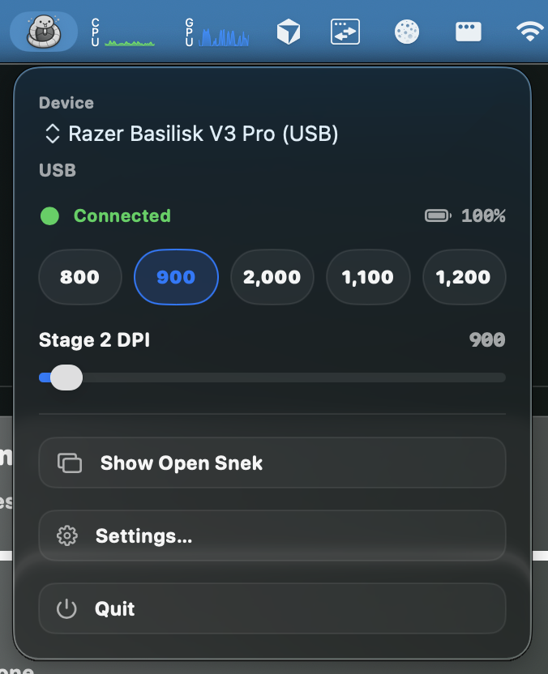
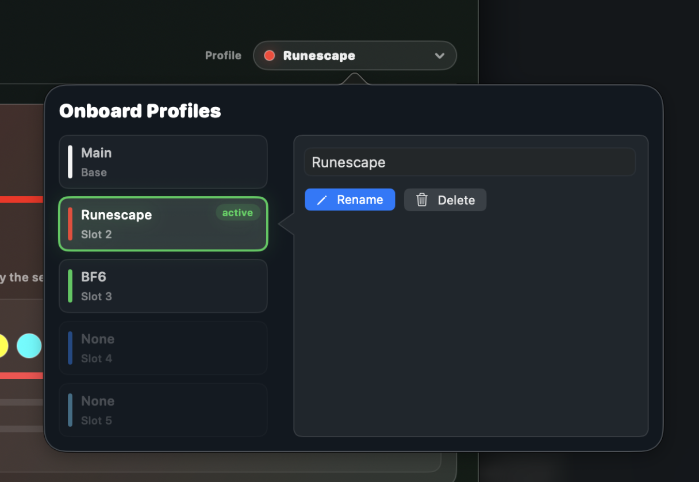
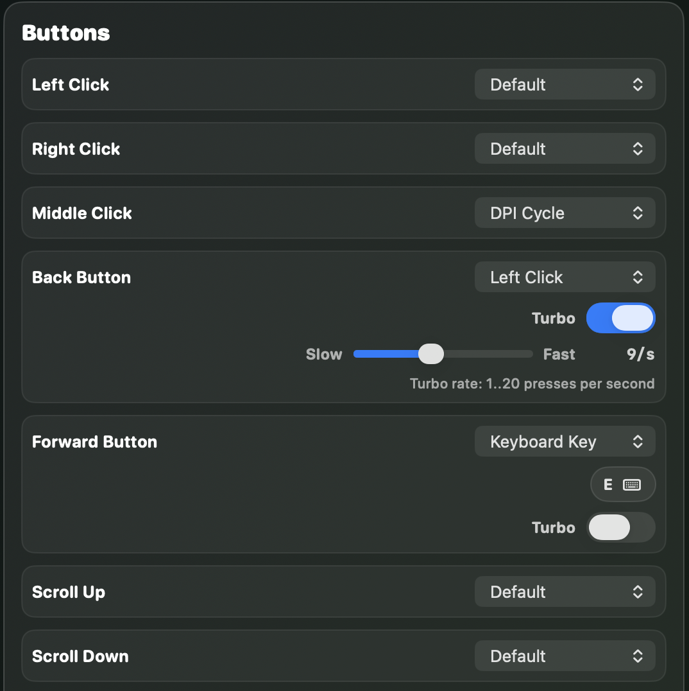

<p align="center">
  
</p>

<h1 align="center">OpenSnek</h1>

<p align="center">
  Configure supported Razer mice on macOS without Synapse, Windows, or vendor lock-in.
</p>

<h2 align="center"><a href="https://github.com/gh123man/OpenSnek/releases">Download</a></h2>


OpenSnek is an open source native macOS app for configuring supported Razer mice over USB or Bluetooth, with early lighting-only support for select Razer keyboards, keypads, and charging accessories.

## Highlights

- Lightweight native macOS app bundle with no unnecessary runtime bloat
- Very low idle and background overhead, so it stays out of the way when you are not using it
- Optional menu bar control for quick, on-the-fly DPI adjustments  
  
- Manage onboard profiles on supported devices  
  
- Rebind all supported mouse buttons and write to onboard storage  
  

## Supported Devices

Support is transport-specific. A device may be supported over USB, Bluetooth, or both, depending on what has been captured, tested, and validated in the app.

| Device | USB | Bluetooth | Notes |
|---|---|---|---|
| Basilisk V3 X HyperSpeed | Validated | Validated | |
| Basilisk V3 | Mapped | No | OpenRazer-backed USB profile, sharing the Basilisk V3 USB family configuration with a `26,000` DPI ceiling |
| Basilisk V3 Pro | Validated | Validated | |
| Basilisk V3 35K | Validated | No | Shares the Basilisk V3 USB family configuration |
| Basilisk V3 Pro 35K Phantom Green Edition | Not yet | Contributor validated | Contributor validated Bluetooth DPI stages, battery, two-zone lighting (no logo LED), and button remap. Onboard profile CRUD stays hidden and Bluetooth changes reset on power cycle; use restore-on-connect |
| Orochi V2 | Not yet | Contributor validated | Contributor validated Bluetooth DPI stages and battery; button remap is profile-mapped pending hardware readback validation. 2.4 GHz HyperSpeed dongle not yet supported. Mouse has no RGB lighting. |
| Naga Pro | Contributor validated | Contributor validated | All three side panels (2-button, 6-button, 12-button) press-validated with captured native defaults, and five-slot onboard profile workflows ship. The underside profile button (slot `14`) cycles saved profiles and is remappable, with Default restoring the cycle; OpenSnek provides no scroll-wheel adjustment for this mouse |
| Naga V2 Pro | Contributor validated | Contributor validated | Wired, 2.4 GHz receiver, and Bluetooth share DPI stages, battery, side-panel remapping, and logo + 12-button side-panel lighting. The 6- and 2-button plates have no lighting, and the two top DPI buttons stay preserved read-only. OpenSnek provides no scroll-wheel adjustment (mode / acceleration / smart reel) for this mouse |
| Naga V3 Pro | Contributor validated | Not yet | 2.4 GHz receiver `0x00E8` only so far. DPI up to the published `50,000` ceiling with independent X/Y, three lighting zones, and every body button remappable, including both scroll-wheel buttons. The mouse's adjustable scroll-wheel settings (tactile / free-spin / smart-reel mode and its responsiveness levels) are not something OpenSnek can read or change: the firmware rejects the scroll-mode command pair and has no mode readout. They stay adjustable outside OpenSnek, with the front scroll button or Synapse on Windows; the rear scroll button does nothing by default. Onboard profile CRUD stays hidden because the device rejects metadata reads. Wired and Bluetooth use unobserved IDs |
| Basilisk (2017) | Contributor validated | No | Contributor validated DPI (scalar, X/Y, live 5-stage table), poll-rate reads, and logo/scroll lighting; button remap not yet mapped |
| Lancehead Tournament Edition | Contributor validated | No | Contributor validated DPI (scalar, X/Y, live 5-stage table), poll-rate reads, and all four lighting zones; button remap not yet mapped |
| Huntsman Mini | Contributor validated | No | Keyboard: contributor validated backlight lighting and brightness. First non-mouse profile; key remap not supported |
| Tartarus Pro | Contributor validated | No | Keypad: contributor validated backlight lighting and brightness. Analog actuation and key remap have no public protocol |
| Mouse Dock | Contributor validated | No | Accessory: one logo LED with static color, brightness, and spectrum/pulse writes. No DPI, buttons, battery, or onboard profiles |
| Mouse Dock Pro | Contributor validated | No | Accessory: one logo LED with brightness, static color, wave, spectrum, and breathing. Answers only transaction ID `0xFF` and reads brightness at a different address than it writes; per-cell custom frames are not mapped yet |

Status key:
- `Validated` = supported and locally capture/test validated in OpenSnek
- `Contributor validated` = support is based on external contributor hardware validation and has not been locally validated by OpenSnek maintainers
- `Mapped` = supported through a shipped profile, but not yet locally validated on OpenSnek hardware
- `Not yet` = the transport exists on the hardware but OpenSnek does not support it yet
- `No` = that transport is not available on the device

Not every feature is fully supported on every listed transport yet. Some controls and readback paths are still partial while capture, testing, and validation continue.

Support docs:
- Per-device USB/BT feature matrix: [docs/DEVICE_SUPPORT.md](docs/DEVICE_SUPPORT.md)
- Getting started with new device support: [docs/development/ADDING_DEVICE_SUPPORT.md](docs/development/ADDING_DEVICE_SUPPORT.md)
- Protocol and transport docs: [docs/protocol/PROTOCOL.md](docs/protocol/PROTOCOL.md)
- Contribution and new-device workflow: [CONTRIBUTING.md](CONTRIBUTING.md)

Unsupported Razer mice still get a best-effort experience when possible. OpenSnek will probe for controls that already match known behavior, show a light warning that the device is not fully supported, and avoid exposing UI for features that have not been mapped safely yet.

Support for more devices is welcome. New device support can land either through outside contributors or as more hardware becomes available for capture, testing, and validation.

## Motivation

Razer does not support the Basilisk V3 X HyperSpeed on macOS at all, so this project started by reverse engineering the BLE protocol from Windows traffic between the mouse and Synapse.

The goal is simple: make supported Razer mice configurable on macOS without needing Synapse, Windows, or a second machine just to change settings.

More device support is welcome, whether that comes from new hardware captures or pull requests. For USB protocol reference work, this project also builds on the excellent documentation and reverse-engineering effort from [OpenRazer](https://github.com/openrazer/openrazer).

## Features

- Change DPI, stage count, and active stage
- Adjusts supported lighting settings
- Remaps supported buttons
- Works over USB and Bluetooth where the device protocol allows it
- Avoids the need for Synapse or a separate Windows machine

## Download and Install

1. Download the latest DMG from [GitHub Releases](https://github.com/gh123man/OpenSnek/releases).
2. Open the DMG.
3. Drag `OpenSnek.app` into `Applications`.
4. Launch `OpenSnek`.

Official builds use the latest Xcode/macOS SDK. Local source builds can use
either full Xcode or Command Line Tools. Minimum supported macOS version:
macOS 14.

If macOS asks for permissions:

- For USB control, grant `Input Monitoring` to `OpenSnek` in `System Settings > Privacy & Security`.
- For Bluetooth control, allow Bluetooth access when prompted.

## Build From Source

From the repo root:

```bash
./run.sh
```

With full Xcode, that rebuilds the canonical `OpenSnek.app` target. On a
Command Line Tools-only Mac, it builds with SwiftPM and assembles the same
stable `.dist` app bundle before launching it through
`OpenSnek/scripts/run_macos_app.sh`. If Command Line Tools provides an older
Swift than the package requires, install the current toolchain with
`brew install swift`; the script detects it without changing `xcode-select` or
`PATH`.

If you want to reuse the current app bundle without rebuilding:

```bash
./run.sh --no-build
```

## Build

```bash
swift build --package-path OpenSnek
```

Direct SwiftPM commands require Swift 6.2 or newer. After `brew install swift`,
either call `/opt/homebrew/opt/swift/bin/swift` directly on Apple silicon or
prepend the Homebrew Swift directory to `PATH`.

## Test

```bash
swift test --package-path OpenSnek
```

Running tests with the above command as-is still requires a full Xcode installation
due to XCTest, but if desired, it is possible to run the test suite on a machine with
only Xcode CLT installed, by extracting XCTest from an Xcode .xip for standalone
usage and pointing swift test to it, but due to the non-reproducible nature of
that procedure, caused by the need to match the Xcode version XCTest is extracted
from to the user's installed Xcode CLT version, which differs by macOS version,
that process will not be documented in detail here, other than noting it can be achieved.

## Xcode

```bash
./OpenSnek/scripts/generate_xcodeproj.sh --open
```

`OpenSnek/OpenSnek.xcodeproj` is generated from `OpenSnek/project.yml` on demand and is not checked into git.

## Project Docs

- App build, run, probe, and validation details: [OpenSnek/README.md](OpenSnek/README.md)
- Device support and reverse-engineering workflow: [CONTRIBUTING.md](CONTRIBUTING.md)
- Getting started with new device support: [docs/development/ADDING_DEVICE_SUPPORT.md](docs/development/ADDING_DEVICE_SUPPORT.md)
- Device support matrix by feature and transport: [docs/DEVICE_SUPPORT.md](docs/DEVICE_SUPPORT.md)
- DMG release and notarization setup: [docs/release/DMG_RELEASE.md](docs/release/DMG_RELEASE.md)
- Protocol documentation: [docs/protocol/PROTOCOL.md](docs/protocol/PROTOCOL.md)
- Kraken Kitty V2 research (unsupported on macOS): [protocol and transport findings](docs/research/KRAKEN_KITTY_V2_MACOS_TRANSPORT_FINDINGS.md)
- Supported Python tooling: [tools/python/README.md](tools/python/README.md)
- BLE capture corpus: [captures/README.md](captures/README.md)

## License

This repository is licensed under the Apache License 2.0. See [LICENSE](LICENSE).
