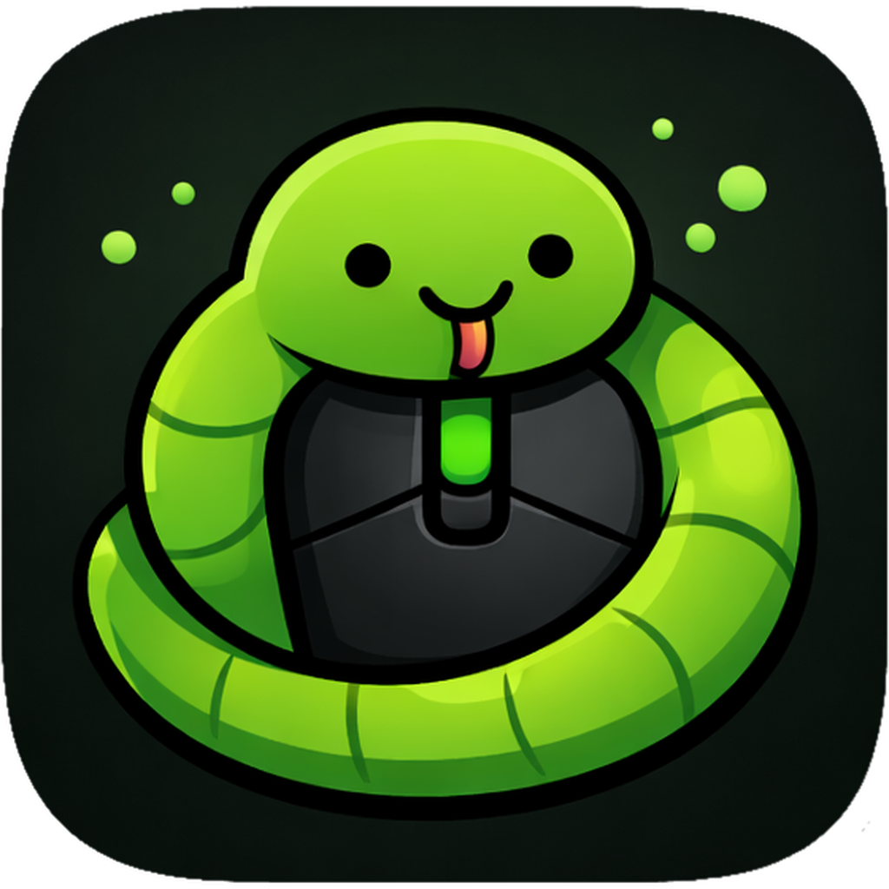
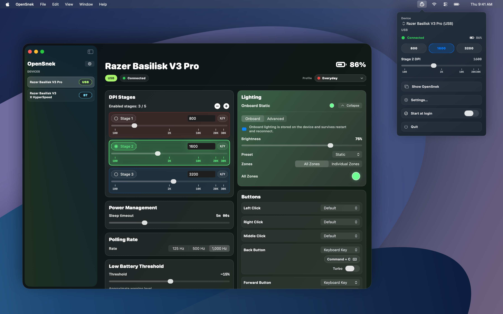

<p align="center">
  
</p>

<h1 align="center">OpenSnek</h1>

<p align="center">
  Configure supported Razer mice on macOS without Synapse, Windows, or vendor lock-in.
</p>

<h2 align="center"><a href="https://github.com/gh123man/OpenSnek/releases">Download</a></h2>



OpenSnek is an open source native macOS app for configuring supported Razer mice over USB or Bluetooth, with early lighting-only support for select Razer keyboards, keypads, and charging accessories.

## Highlights

- Lightweight native macOS app bundle with no unnecessary runtime bloat
- Very low idle and background overhead, so it stays out of the way when you are not using it
- Optional menu bar control for quick, on-the-fly DPI adjustments
- Manage onboard profiles on supported devices
- Rebind all supported mouse buttons and write to onboard storage

## Supported Devices

**✅ Supported · 🧪 Mapped, awaiting hardware validation · ❌ Not implemented · `-` Not supported by hardware**

### Mice

| Device | USB / receiver | Bluetooth | Main limitations |
|---|:---:|:---:|---|
| Basilisk V3 X HyperSpeed | ✅ | ✅ | Bluetooth lighting: static only |
| Basilisk V3 | 🧪 | - | Awaiting hardware validation |
| Basilisk V3 Pro | ✅ | ✅ | Bluetooth lighting: static only |
| Basilisk V3 35K | ✅ | - | |
| Basilisk V3 Pro 35K Phantom Green Edition | 🧪 | ✅ | No onboard profiles or USB software lighting; Bluetooth: restore-on-connect |
| Orochi V2 | ❌ | ✅ | Button remapping awaits validation; no RGB hardware |
| Naga Pro | ✅ | ✅ | No scroll-wheel settings |
| Naga V2 Pro | ✅ | ✅ | No scroll-wheel settings; top DPI buttons read-only |
| Naga V3 Pro | ✅ | ✅ | No scroll-wheel settings or onboard profile management |
| Basilisk (2017) | ✅ | - | No button remapping |
| Lancehead Tournament Edition | ✅ | - | No button remapping |

### Lighting-only devices

| Device | USB | Bluetooth |
|---|:---:|:---:|
| Huntsman Mini | ✅ | - |
| Tartarus Pro | ✅ | - |
| Mouse Dock | ✅ | - |
| Mouse Dock Pro | ✅ | - |

USB includes wired connections or USB wireless receivers, depending on the model.
Available features vary by device and connection. Supported connections include
both maintainer- and contributor-validated hardware; validation details and
contributor credits are in the full feature matrix.

[Full feature matrix](docs/DEVICE_SUPPORT.md) · [Help add device support](docs/development/ADDING_DEVICE_SUPPORT.md)

## Motivation

Razer does not support the Basilisk V3 X HyperSpeed on macOS at all, so this project started by reverse engineering the BLE protocol from Windows traffic between the mouse and Synapse.

The goal is simple: make supported Razer mice configurable on macOS without needing Synapse, Windows, or a second machine just to change settings.

More device support is welcome, whether that comes from new hardware captures or pull requests. For USB protocol reference work, this project also builds on the excellent documentation and reverse-engineering effort from [OpenRazer](https://github.com/openrazer/openrazer).

## Features

- Change DPI, stage count, and active stage
- Adjusts supported lighting settings
- Remaps supported buttons
- Works over USB and Bluetooth where the device protocol allows it
- Avoids the need for Synapse or a separate Windows machine

## Download and Install

1. Download the latest DMG from [GitHub Releases](https://github.com/gh123man/OpenSnek/releases).
2. Open the DMG.
3. Drag `OpenSnek.app` into `Applications`.
4. Launch `OpenSnek`.

Official builds use the latest Xcode/macOS SDK. Local source builds can use
either full Xcode or Command Line Tools. Minimum supported macOS version:
macOS 14.

If macOS asks for permissions:

- For USB control, grant `Input Monitoring` to `OpenSnek` in `System Settings > Privacy & Security`.
- For Bluetooth control, allow Bluetooth access when prompted.

## Build From Source

From the repo root:

```bash
./run.sh
```

With full Xcode, that rebuilds the canonical `OpenSnek.app` target. On a
Command Line Tools-only Mac, it builds with SwiftPM and assembles the same
stable `.dist` app bundle before launching it through
`OpenSnek/scripts/run_macos_app.sh`. If Command Line Tools provides an older
Swift than the package requires, install the current toolchain with
`brew install swift`; the script detects it without changing `xcode-select` or
`PATH`.

If you want to reuse the current app bundle without rebuilding:

```bash
./run.sh --no-build
```

## Build

```bash
swift build --package-path OpenSnek
```

Direct SwiftPM commands require Swift 6.2 or newer. After `brew install swift`,
either call `/opt/homebrew/opt/swift/bin/swift` directly on Apple silicon or
prepend the Homebrew Swift directory to `PATH`.

## Test

```bash
swift test --package-path OpenSnek
```

Running tests with the above command as-is still requires a full Xcode installation
due to XCTest, but if desired, it is possible to run the test suite on a machine with
only Xcode CLT installed, by extracting XCTest from an Xcode .xip for standalone
usage and pointing swift test to it, but due to the non-reproducible nature of
that procedure, caused by the need to match the Xcode version XCTest is extracted
from to the user's installed Xcode CLT version, which differs by macOS version,
that process will not be documented in detail here, other than noting it can be achieved.

## Xcode

```bash
./OpenSnek/scripts/generate_xcodeproj.sh --open
```

`OpenSnek/OpenSnek.xcodeproj` is generated from `OpenSnek/project.yml` on demand and is not checked into git.

## Project Docs

- App build, run, probe, and validation details: [OpenSnek/README.md](OpenSnek/README.md)
- Device support and reverse-engineering workflow: [CONTRIBUTING.md](CONTRIBUTING.md)
- Getting started with new device support: [docs/development/ADDING_DEVICE_SUPPORT.md](docs/development/ADDING_DEVICE_SUPPORT.md)
- Device support matrix by feature and transport: [docs/DEVICE_SUPPORT.md](docs/DEVICE_SUPPORT.md)
- DMG release and notarization setup: [docs/release/DMG_RELEASE.md](docs/release/DMG_RELEASE.md)
- Protocol documentation: [docs/protocol/PROTOCOL.md](docs/protocol/PROTOCOL.md)
- Kraken Kitty V2 research (unsupported on macOS): [protocol and transport findings](docs/research/KRAKEN_KITTY_V2_MACOS_TRANSPORT_FINDINGS.md)
- Supported Python tooling: [tools/python/README.md](tools/python/README.md)
- BLE capture corpus: [captures/README.md](captures/README.md)

## License

This repository is licensed under the Apache License 2.0. See [LICENSE](LICENSE).
